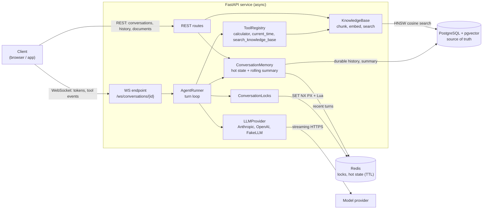
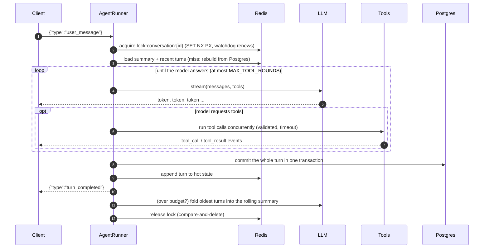

# realtime-agent-backend

[](https://github.com/tavlant/realtime-agent-backend/actions/workflows/ci.yml)


A production-style **FastAPI backend for LLM chat agents**: assistant replies stream token by
token over WebSockets, the agent can call tools, conversations have durable memory, and a
small RAG pipeline answers questions from your own documents.

It is built the way I'd build this for real traffic: async end to end, safe under concurrency,
resilient to slow or flaky model providers, observable, and **fully runnable offline**. No API
key is needed to run it, test it or load-test it.

**Highlights**

- **Streaming over WebSockets.** `/ws/conversations/{id}` streams tokens, tool calls and tool results as typed JSON events.
- **Two-tier memory.** Recent context lives in Redis (with a TTL); Postgres keeps the full history and is the source of truth. Older turns are folded into a **rolling summary** once the context goes over a token budget.
- **No interleaved turns.** A per-conversation **distributed Redis lock** (random owner token, TTL plus watchdog renewal) keeps turns in order across tabs and replicas.
- **Tool calling.** A typed tool registry (Pydantic-validated arguments, timeouts, error isolation) with a safe AST calculator, a clock and knowledge-base search. The agent loop runs tool calls concurrently and feeds the results back to the model.
- **Mini RAG.** Ingest Markdown or text, then chunk (heading-aware), embed, store in **pgvector** (HNSW index) and search semantically. An in-memory store is used for dev and tests.
- **Provider abstraction.** **Anthropic** and **OpenAI** adapters (streaming plus tool calls) sit behind one interface, plus a deterministic **FakeLLM** for tests and offline use.
- **Reliability.** First-token and idle timeouts, retries with exponential backoff and jitter (only before the first token, so output is never duplicated), atomic turn commits, graceful drain of in-flight turns on shutdown.
- **Observability.** Structured JSON logs that carry `request_id`, `conversation_id` and `turn_id` automatically. Per-turn timings (lock wait, time to first token, total). Optional OpenTelemetry tracing.
- **Tested.** 109 tests run in about 15 s without Docker, including a **50-concurrent-conversation** WebSocket test that checks no history is lost or mixed.

---

## Architecture



### Life of a turn



---

## Design decisions

**Why Redis and Postgres, not just one?**
Every turn needs the recent context *right now*. Re-reading and re-sorting the full history
from Postgres on each turn costs latency and database load for nothing. Redis holds the hot
state (rolling summary plus the not-yet-summarised messages) with a sliding TTL, so idle
conversations fall out of memory on their own. Postgres stays the **source of truth**. The
write path is *Postgres first, then Redis*. If the Redis write fails, the hot keys are deleted
and rebuilt from Postgres on the next read. So the cache can be missing but never wrong, and
Redis can be flushed at any time without losing data.

**Why a distributed lock per conversation?**
A user can have the same conversation open in two tabs, and the API runs as several
replicas. Without a lock, two turns can read the same context and write interleaved
messages. The lock is `SET key token NX PX ttl`: atomic, with a TTL so a crashed worker
can't hold it forever. Waiters poll with capped exponential backoff and jitter. A watchdog
renews the TTL during slow model calls. Release and renew are Lua compare-and-act scripts
on a random token, so a worker whose lock expired can never release someone else's lock. If
the lock is lost mid-turn, the turn is refused before commit. A unique
`(conversation_id, seq)` constraint in Postgres is the final safety net.

**Why atomic turns?**
A turn's user message, tool calls, tool results and final answer are committed in **one
transaction** after the answer is complete. History therefore only ever contains whole turns:
no dangling tool calls and no half-written replies after a crash. Turns run as tracked
tasks, shielded from the socket handler, so **a client that disconnects mid-stream still gets
the answer saved**. On shutdown the server drains in-flight turns before closing pools.

**Why a rolling summary?**
Context windows are large but not free: cost and latency grow with every token you resend.
When the unsummarised context goes over `CONTEXT_TOKEN_BUDGET`, the oldest turns are folded
into a summary that rides along in the system prompt. Cut points are only placed **before a
user message**, so a tool call is never separated from its result (providers reject that). It
runs *after* `turn_completed` is sent, so the user never waits for it, but still inside the
lock, so it can't race the next turn. If summarisation fails, the turn still succeeds and the
full context is kept. Postgres keeps every original message either way.

**Why a provider abstraction?**
The agent loop, memory and tools only speak neutral types (`ChatMessage`, `ToolCall`,
`TextDelta`, ...). Each adapter translates to its vendor's wire format. For example, the
Anthropic adapter merges parallel tool results into one user turn, and the OpenAI adapter
reassembles tool-call arguments that arrive in fragments. Switching vendors is a config
change. Retries happen in one place with stream-aware rules instead of in each SDK.

**Why an offline FakeLLM?**
Tests that call a real model are slow, flaky and cost money, and they can't assert exact
output. `FakeLLM` is deterministic and follows a few visible rules: arithmetic triggers
the calculator, "time" triggers the clock, "search ..." triggers the knowledge base, and
anything else is echoed. That is enough to exercise streaming, the tool loop, summarisation
and concurrency end to end. It is also the default when no API key is set, so anyone can
clone the repo and run it in a minute.

**Retries without duplicate output.**
A failed stream is retried (with backoff) only if *no token has reached the client yet*.
After the first token, a retry would repeat text the user already saw, so the error is
surfaced instead (`{"type":"error","retryable":true}`). Stalled providers are cut off by a
first-token timeout and an inter-token idle timeout.

---

## Quickstart

### Option A: Docker (API + Postgres/pgvector + Redis)

```bash
cp .env.example .env          # optional: add ANTHROPIC_API_KEY or OPENAI_API_KEY
docker compose up --build
```

- API: http://localhost:8000, interactive docs at http://localhost:8000/docs
- Readiness: `curl localhost:8000/readyz` returns `{"status":"ready","database":true,"redis":true,...}`
- Ports clash with something else? Use `API_PORT=18000 POSTGRES_PORT=15432 REDIS_PORT=16379 docker compose up`

### Option B: local, zero infrastructure (SQLite + in-process Redis + FakeLLM)

```bash
python -m venv .venv
source .venv/bin/activate        # Windows: .venv\Scripts\activate
pip install -e ".[dev]"

# bash
DATABASE_URL=sqlite+aiosqlite:///./dev.db REDIS_URL=memory:// FAKE_LLM_TOKEN_DELAY_MS=30 \
  uvicorn agent_backend.main:create_app --factory --reload
```

```powershell
# PowerShell
$env:DATABASE_URL="sqlite+aiosqlite:///./dev.db"; $env:REDIS_URL="memory://"; $env:FAKE_LLM_TOKEN_DELAY_MS="30"
uvicorn agent_backend.main:create_app --factory --reload
```

### Talk to it

```bash
python scripts/ingest_docs.py examples/docs            # load sample documents
python scripts/ws_client.py "Hello" "What is 12 * (3 + 4)?" "what time is it?" "search refunds annual plans"
python scripts/ws_client.py                             # interactive chat
```

```text
you > What is 12 * (3 + 4)?
bot >
  [tool call] calculator({"expression": "12 * (3 + 4)"})
  [tool result] 84
bot > The answer is 84.
  [done] tokens in/out: 135/13
```

### Use a real model

Set one key in `.env` and restart. With `LLM_PROVIDER=auto` (the default), Anthropic is used
when `ANTHROPIC_API_KEY` is set, otherwise OpenAI when `OPENAI_API_KEY` is set, otherwise
FakeLLM. Models are configurable (`ANTHROPIC_MODEL`, `OPENAI_MODEL`). For semantic rather
than lexical document search, set `EMBEDDING_PROVIDER=openai`.

---

## API

| Method | Path | Purpose |
|---|---|---|
| `GET` | `/healthz` | Liveness |
| `GET` | `/readyz` | Readiness (Postgres + Redis reachable), 503 when degraded |
| `POST` | `/conversations` | Create a conversation `{"title": "optional"}` |
| `GET` | `/conversations?limit&offset` | List conversations, most recently active first |
| `GET` | `/conversations/{id}` | Conversation metadata, including the rolling summary |
| `GET` | `/conversations/{id}/messages?limit&before_seq` | Full history from Postgres, paginated |
| `POST` | `/documents` | Ingest a document `{"source": "faq.md", "content": "..."}` |
| `GET` | `/documents/search?q&k` | Semantic search over ingested chunks |
| `WS` | `/ws/conversations/{id}` | Streaming chat (protocol below) |

Every HTTP response carries an `X-Request-ID` header. A valid incoming one is reused, so a request can be traced across services.

### WebSocket protocol

```jsonc
// client -> server
{"type": "user_message", "content": "What is 12 * (3 + 4)?"}
{"type": "ping"}

// server -> client
{"type": "ready", "conversation_id": "...", "connection_id": "..."}
{"type": "turn_started", "turn_id": "..."}
{"type": "token", "turn_id": "...", "text": "The "}
{"type": "tool_call", "turn_id": "...", "id": "...", "name": "calculator", "arguments": {"expression": "12 * (3 + 4)"}}
{"type": "tool_result", "turn_id": "...", "id": "...", "name": "calculator", "content": "84", "is_error": false}
{"type": "turn_completed", "turn_id": "...", "content": "The answer is 84.", "tool_rounds": 1, "usage": {"input_tokens": 135, "output_tokens": 13}}
{"type": "error", "code": "conversation_busy | upstream_unavailable | invalid_message | not_found | internal_error", "message": "...", "retryable": true}
```

### Minimal client (Python)

```python
import asyncio, json
import httpx
from websockets.asyncio.client import connect


async def main() -> None:
    async with httpx.AsyncClient(base_url="http://localhost:8000") as http:
        conversation_id = (await http.post("/conversations")).json()["id"]

    async with connect(f"ws://localhost:8000/ws/conversations/{conversation_id}") as ws:
        await ws.recv()  # {"type": "ready", ...}
        await ws.send(json.dumps({"type": "user_message", "content": "What is 2 ** 10?"}))
        while True:
            event = json.loads(await ws.recv())
            if event["type"] == "token":
                print(event["text"], end="", flush=True)
            elif event["type"] in ("turn_completed", "error"):
                break


asyncio.run(main())
```

### Minimal client (browser)

```js
const { id } = await (await fetch("/conversations", { method: "POST" })).json();
const ws = new WebSocket(`ws://${location.host}/ws/conversations/${id}`);
ws.onopen = () => ws.send(JSON.stringify({ type: "user_message", content: "Hi!" }));
ws.onmessage = ({ data }) => {
  const event = JSON.parse(data);
  if (event.type === "token") output.textContent += event.text;
};
```

---

## Tests

```bash
pytest            # 109 tests in about 15 s: SQLite (aiosqlite) + fakeredis + FakeLLM, no Docker
ruff check . && ruff format --check .
```

| Suite | What it proves |
|---|---|
| `unit/test_calculator.py` | AST evaluator accepts arithmetic and rejects `__import__`, attribute access, names, `9**9**9`, complex results, oversized input |
| `unit/test_chunking.py` | Size limits, overlap, no lost content, Markdown heading paths, fenced code blocks |
| `unit/test_tool_registry.py` | Schema generation, argument validation, timeouts, crash isolation, concurrent execution |
| `unit/test_locks.py` | Mutual exclusion, owner-only release, TTL takeover, watchdog renewal, lost-lock detection |
| `unit/test_summarizer.py` | Cut points never split tool calls, summary persisted to Postgres and Redis, failure keeps full context, cache rebuild |
| `unit/test_retry.py` | Backoff, give-up, no retry after first token, stall timeouts |
| `unit/test_providers.py` | OpenAI and Anthropic wire translation, streamed tool-call reassembly, FakeLLM rules |
| `unit/test_rag.py` | Deterministic embeddings, ranking, ingestion, search tool output |
| `integration/test_websocket.py` | Token streaming, tool loop, tool errors, RAG tool, summarisation, disconnect mid-turn still persists |
| `integration/test_concurrency.py` | **50 simultaneous WebSocket conversations** with complete, ordered, unmixed histories; 15 concurrent turns on *one* conversation run strictly one at a time |
| `integration/test_rest.py` | Health and readiness, CRUD, pagination, validation, request IDs, document search |

CI (GitHub Actions) runs lint, the test suite on Python 3.10 and 3.12, then builds the Docker
image and smoke-tests the full compose stack (Postgres + pgvector + Redis) with the load test.

## Load test

```bash
python scripts/load_test.py --url http://localhost:8000 --conversations 100 --turns 3
```

Sample run: Docker Compose stack, FakeLLM, **one** uvicorn worker, Docker Desktop on a
Windows laptop, load generator on the same machine:

```text
conversations     100 x 3 turns
completed turns   300 / 300
errors            0
throughput        55.4 turns/s, 610 tokens/s
turn latency      p50 656 ms | p95 1798 ms | p99 2549 ms
time to 1st token p50 288 ms | p95 1112 ms
(single user:     p50 15 ms per turn, 4 ms to first token)
```

With FakeLLM this measures the backend's own overhead (locking, Redis, Postgres, WebSocket
fan-out). With a real model, latency is dominated by the provider. Under load, time goes to
Redis and Postgres round trips, not CPU. Scaling out is horizontal: add uvicorn workers or
replicas, which the distributed lock already supports.

---

## Configuration

All settings come from environment variables (or `.env`). See [.env.example](.env.example).
The most important ones:

| Variable | Default | Meaning |
|---|---|---|
| `DATABASE_URL` | `sqlite+aiosqlite:///./dev.db` | Postgres in production (`postgresql+asyncpg://...`) |
| `REDIS_URL` | `redis://localhost:6379/0` | `memory://` for an in-process fake (dev only) |
| `LLM_PROVIDER` | `auto` | `auto`, `fake`, `anthropic` or `openai` |
| `CONTEXT_TOKEN_BUDGET` | `3000` | Summarise older turns above this size |
| `MAX_TOOL_ROUNDS` | `5` | Upper bound on tool-call iterations per turn |
| `LLM_FIRST_TOKEN_TIMEOUT_S` / `LLM_IDLE_TIMEOUT_S` | `30` / `30` | Stream timeouts |
| `LLM_MAX_ATTEMPTS` | `3` | Retries before the first token |
| `LOCK_TTL_S` / `LOCK_WAIT_TIMEOUT_S` | `30` / `20` | Conversation lock tuning |
| `VECTOR_STORE` | `auto` | `pgvector` on Postgres, else `memory` |
| `EMBEDDING_PROVIDER` | `hashing` | `hashing` (offline) or `openai` |
| `OTEL_ENABLED` | `false` | Export traces over OTLP (`pip install -e ".[otel]"`) |

## Project layout

```text
src/agent_backend/
  main.py              app factory, lifespan
  container.py         composition root, tracked turns, graceful drain
  config.py            pydantic-settings
  log.py               JSON logging + contextvars (request/conversation/turn IDs)
  telemetry.py         optional OpenTelemetry
  api/                 REST routes, WebSocket endpoint, request-ID middleware, schemas
  core/                agent loop, memory, locks, summariser, retries, token estimates
  llm/                 provider interface, Anthropic, OpenAI, FakeLLM
  tools/               registry, calculator, clock, knowledge search
  rag/                 chunking, embeddings, vector stores, knowledge base
  db/                  models, async engine, repository
tests/                 unit + integration (offline)
scripts/               load_test.py, ws_client.py, ingest_docs.py
examples/docs/         sample documents for the knowledge base
```

## Trade-offs and limitations

- **Schema bootstrap** uses `create_all` at startup. A real deployment would use Alembic migrations.
- **No authentication.** Conversations are addressable by ID. Production needs auth (JWT or API keys) and per-user ownership checks.
- **Locks and fencing.** The Redis lock plus the lost-lock check before commit plus the unique sequence constraint is strong in practice. A strictly correct design under long GC pauses or clock skew would pass a fencing token to Postgres.
- **The hashing embedder** is lexical, not semantic. It exists so RAG runs offline. Use `EMBEDDING_PROVIDER=openai` for real semantic search.
- **Token counts** are estimated (about 4 characters per token) for budgeting. Exact per-provider counts would need the provider's tokenizer or count endpoint.
- **A failed turn is not persisted** (atomic turns). The client gets a `retryable` error and can resend.
- **Anthropic thinking blocks are not replayed.** History stays provider-neutral (text and tool calls only). The API accepts this, but replaying the blocks inside one turn's tool loop would give the model better reasoning continuity.
- **The Anthropic and OpenAI adapters** are unit-tested against recorded wire shapes, not live APIs, because CI runs without keys.

## Roadmap

- [ ] Alembic migrations
- [ ] Auth (JWT) and per-user conversation ownership
- [ ] Client-initiated cancellation (`{"type": "cancel"}`) and resumable streams after reconnect
- [ ] Redis Streams fan-out so several sockets can watch one conversation live
- [ ] Rate limiting and per-user token quotas
- [ ] Hybrid search (BM25 + vectors) and re-ranking
- [ ] Prometheus metrics endpoint (turn latency, TTFT, tool errors, lock wait)

## License

[MIT](LICENSE) © Taulant Gashi
