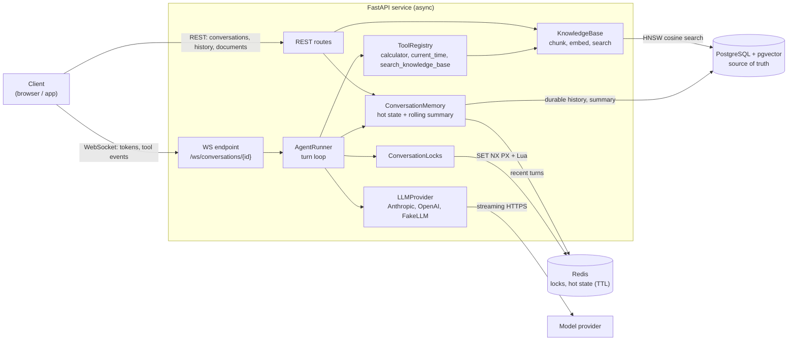

# realtime-agent-backend

[](https://github.com/tavlant/realtime-agent-backend/actions/workflows/ci.yml)

[](https://docs.astral.sh/ruff/)
[](https://mypy-lang.org/)


A production-style **FastAPI backend for LLM chat agents**: assistant replies stream token by
token over WebSockets, the agent can call tools, conversations have durable memory, and a
small RAG pipeline answers questions from your own documents.

It is built the way I'd build this for real traffic: async end to end, safe under concurrency,
resilient to slow or flaky model providers, observable, and **fully runnable offline**. No API
key is needed to run it, test it or load-test it.

**Highlights**

- **Streaming over WebSockets.** `/ws/conversations/{id}` streams tokens, tool calls and tool results as typed JSON events.
- **Two-tier memory.** Recent context lives in Redis (with a TTL); Postgres keeps the full history and is the source of truth. Older turns are folded into a **rolling summary** once the context goes over a token budget.
- **No interleaved turns.** A per-conversation **distributed Redis lock** (random owner token, TTL plus watchdog renewal) keeps turns in order across tabs and replicas.
- **Tool calling.** A typed tool registry (Pydantic-validated arguments, timeouts, error isolation) with a safe AST calculator, a clock and knowledge-base search. The agent loop runs tool calls concurrently and feeds the results back to the model.
- **Mini RAG.** Ingest Markdown or text, then chunk (heading-aware), embed, store in **pgvector** (HNSW index) and search semantically. An in-memory store is used for dev and tests.
- **Provider abstraction.** **Anthropic** and **OpenAI** adapters (streaming plus tool calls) sit behind one interface, plus a deterministic **FakeLLM** for tests and offline use.
- **Reliability.** First-token and idle timeouts, retries with exponential backoff and jitter (only before the first token, so output is never duplicated), atomic turn commits, graceful drain of in-flight turns on shutdown.
- **Observability.** Structured JSON logs that carry `request_id`, `conversation_id` and `turn_id` automatically. Per-turn timings (lock wait, time to first token, total). Optional OpenTelemetry tracing.
- **Schema migrations.** Alembic migrations, applied before the API starts in Docker, with a test that fails if models and migrations drift.
- **Tested and typed.** 111 tests (about 88% coverage, enforced at 85%) run in about 20 s without Docker, including a **50-concurrent-conversation** WebSocket test. `mypy --strict` passes.

---

## Architecture



A turn takes the conversation lock, loads the hot context from Redis, streams the model's answer
(running tool calls concurrently in between), commits the whole turn to Postgres in one
transaction, then updates Redis. The full sequence and the reasoning behind each choice are in
[docs/architecture.md](docs/architecture.md) and the [decision records](docs/adr/README.md).

---

## Quickstart

### Option A: Docker (API + Postgres/pgvector + Redis)

```bash
cp .env.example .env          # optional: add ANTHROPIC_API_KEY or OPENAI_API_KEY
docker compose up --build     # applies migrations, then starts the API
```

- API: http://localhost:8000, interactive docs at http://localhost:8000/docs
- Readiness: `curl localhost:8000/readyz`
- Ports clash with something else? Use `API_PORT=18000 POSTGRES_PORT=15432 REDIS_PORT=16379 docker compose up`

### Option B: local, zero infrastructure (SQLite + in-process Redis + FakeLLM)

```bash
uv sync --extra dev           # or: python -m venv .venv && pip install -e ".[dev]"
make run-offline              # on Windows without make, see docs/configuration.md
```

### Talk to it

```bash
python scripts/ingest_docs.py examples/docs            # load sample documents
python scripts/ws_client.py "What is 12 * (3 + 4)?" "what time is it?" "search refunds annual plans"
```

```text
you > What is 12 * (3 + 4)?
bot >
  [tool call] calculator({"expression": "12 * (3 + 4)"})
  [tool result] 84
bot > The answer is 84.
  [done] tokens in/out: 135/13
```

---

## Development

```bash
make lint        # ruff check + format check
make typecheck   # mypy --strict
make test        # 111 tests with coverage, offline, about 20 s
make migration m="add column x"   # new Alembic migration
make migrate                      # apply migrations to DATABASE_URL
```

Dependencies are locked in `uv.lock`; CI and the Docker image install from the lockfile.
Pre-commit hooks: `pre-commit install`.

## Documentation

| Doc | What's inside |
|---|---|
| [Architecture](docs/architecture.md) | Components, life of a turn, failure handling, code map, trade-offs |
| [Decision records](docs/adr/README.md) | Why Redis + Postgres, the conversation lock, atomic turns, summaries, retries, migrations |
| [API](docs/api.md) | REST endpoints, the WebSocket protocol, minimal Python and browser clients |
| [Configuration](docs/configuration.md) | Environment variables and using a real model |
| [Testing](docs/testing.md) | What each test suite proves, CI, and load-test results |

## Project layout

```text
src/agent_backend/
  main.py              app factory, lifespan
  container.py         composition root, tracked turns, graceful drain
  config.py            pydantic-settings
  log.py               JSON logging + contextvars (request/conversation/turn IDs)
  telemetry.py         optional OpenTelemetry
  api/                 REST routes, WebSocket endpoint, request-ID middleware, schemas
  core/                agent loop, memory, locks, summariser, retries, token estimates
  llm/                 provider interface, Anthropic, OpenAI, FakeLLM
  tools/               registry, calculator, clock, knowledge search
  rag/                 chunking, embeddings, vector stores, knowledge base
  db/                  models, async engine, repository
migrations/            Alembic environment and versioned schema migrations
tests/                 unit + integration (offline)
scripts/               load_test.py, ws_client.py, ingest_docs.py
docs/                  architecture, ADRs, API, configuration, testing
examples/docs/         sample documents for the knowledge base
```

## Roadmap

- [x] Alembic migrations
- [ ] Auth (JWT) and per-user conversation ownership
- [ ] Client-initiated cancellation (`{"type": "cancel"}`) and resumable streams after reconnect
- [ ] Redis Streams fan-out so several sockets can watch one conversation live
- [ ] Rate limiting and per-user token quotas
- [ ] Hybrid search (BM25 + vectors) and re-ranking
- [ ] Prometheus metrics endpoint (turn latency, TTFT, tool errors, lock wait)

## License

[MIT](LICENSE) © Taulant Gashi
