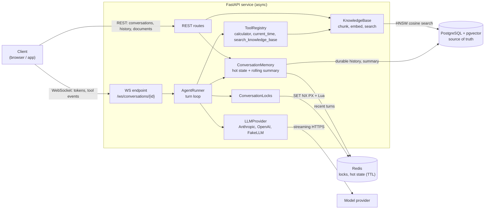
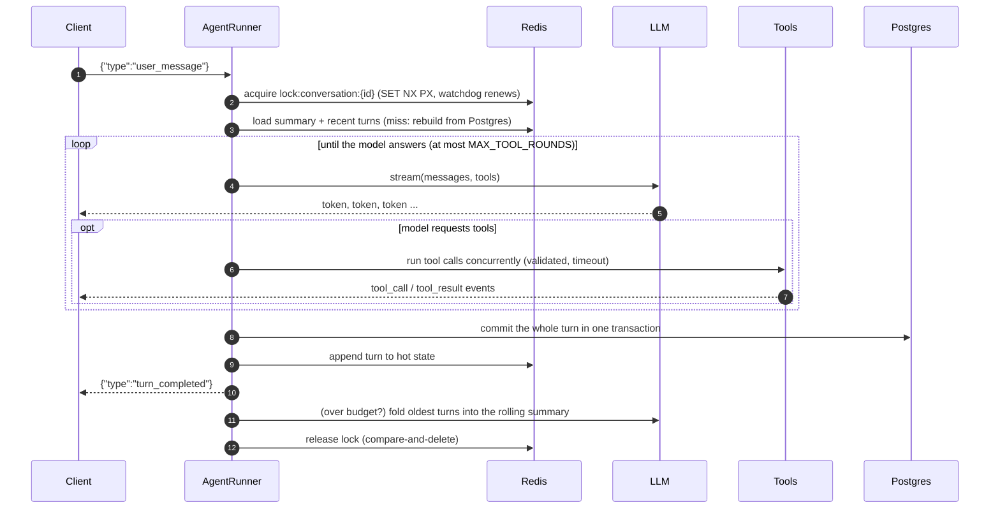

# Architecture

How a request flows through the service, and why it is built this way. The individual design
decisions are recorded as [ADRs](adr/README.md).

## Components

## Life of a turn

## Write path and failure handling

- **Postgres first, then Redis.** A turn is committed to Postgres in one transaction, then appended
  to the Redis hot state. If the Redis write fails, the hot keys are dropped and rebuilt from
  Postgres on the next read. See [ADR 0001](adr/0001-redis-hot-state-postgres-source-of-truth.md).
- **One turn at a time per conversation**, across tabs and replicas, via a Redis lock with a
  watchdog. See [ADR 0002](adr/0002-per-conversation-distributed-lock.md).
- **Turns are atomic** and survive client disconnects. See [ADR 0003](adr/0003-atomic-turn-commits.md).
- **Schema changes go through Alembic.** See [ADR 0007](adr/0007-alembic-migrations.md).

## Code map

| Package | Responsibility |
|---|---|
| `api/` | REST routes, WebSocket endpoint, request-ID middleware, Pydantic schemas |
| `core/` | Agent turn loop, conversation memory, locks, summariser, retry policy, token estimates |
| `llm/` | Provider-neutral interface plus Anthropic, OpenAI and FakeLLM adapters |
| `tools/` | Typed tool registry and the built-in tools |
| `rag/` | Chunking, embeddings, vector stores, knowledge-base service |
| `db/` | ORM models, async engine, repository |
| `container.py` | Composition root: builds and owns every long-lived dependency |

Dependencies point inwards: `api` depends on `core`, `core` depends on the `llm`, `tools` and `db`
interfaces, and only `container.py` knows about concrete implementations.

## Trade-offs and limitations

- **No authentication.** Conversations are addressable by ID. Production needs auth (JWT or API keys) and per-user ownership checks.
- **Locks and fencing.** The Redis lock plus the lost-lock check before commit plus the unique sequence constraint is strong in practice. A strictly correct design under long GC pauses or clock skew would pass a fencing token to Postgres.
- **The hashing embedder** is lexical, not semantic. It exists so RAG runs offline. Use `EMBEDDING_PROVIDER=openai` for real semantic search.
- **Token counts** are estimated (about 4 characters per token) for budgeting. Exact per-provider counts would need the provider's tokenizer or count endpoint.
- **A failed turn is not persisted** (atomic turns). The client gets a `retryable` error and can resend.
- **Anthropic thinking blocks are not replayed.** History stays provider-neutral (text and tool calls only). The API accepts this, but replaying the blocks inside one turn's tool loop would give the model better reasoning continuity.
- **The Anthropic and OpenAI adapters** are unit-tested against recorded wire shapes, not live APIs, because CI runs without keys.
